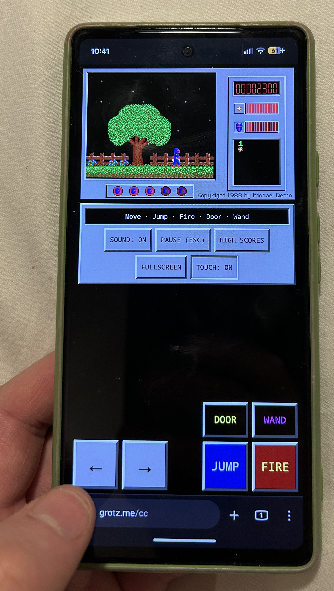

# Captain Comic - Web Port

<p align="center">
  
</p>

A native browser port of **The Adventures of Captain Comic**, Episode I:
*Planet of Death*, originally created by **Michael A. Denio**.

The game runs in vanilla JavaScript using Canvas and Web Audio-**not a DOS
emulator**. It has a full screen mode and you can toggle buttons to play on touch screens. 

**This is a source-only repository for the port, not a distribution of the DOS
game.** Original game files and generated assets are not included. You can supply
your own copy to generate the assets and play locally.

[Web Demo](https://grotz.me/cc/)

## Features and status

- All eight areas, original enemies, tools, pickups, doors and linked playfields.
- Original-style movement, combat, lives, shield/weapon energy and PC-speaker audio.
- Startup screens, victory sequence, pause and browser-local high scores.
- Fullscreen/expanded view and large multi-touch controls for mobile play.
- Game-like EGA colors, pixel-art rendering and square, beveled website controls.
- Reverse-engineering documentation and executable-backed regression tests.

The port is playable but still under development. A complete DOS-versus-web
playthrough and remaining same-tick edge cases still need verification. Continue
resumes a paused run; **there is no gameplay save/load across page reloads**.
Physical-device and native-fullscreen testing remain useful.

## Run locally

### Requirements

- Python 3 with `numpy` and `Pillow` for asset generation and the local HTTP server.
- Original Episode I game files, supplied separately. The exporter was developed
  against the Revision 5 files described in the technical reference below.
- Node.js only if you want to run the JavaScript tests; it is not needed to play.

### Setup

```sh
git clone https://github.com/BitsAndDopamine/captain-comic-web-port.git
cd captain-comic-web-port
```

With your preferred Python virtual environment activated, install the export
dependencies:

```sh
python3 -m pip install numpy Pillow
```

Place the original files directly in a local `game files/` directory, keeping
their original names (including uppercase filenames on case-sensitive systems).
Do not modify the originals. Then generate the web assets and start the server:

```sh
python3 tools/export_web_assets.py
python3 -m http.server 8791 --directory web
```

Open **http://localhost:8791/**. Serve the game over HTTP rather than opening
`web/index.html` directly. A fresh checkout will not run until assets have been
generated; simply deploying this source-only checkout to GitHub Pages is not a
ready-to-play distribution.

## Browser controls

| Key | Action |
|---|---|
| Left / Right arrows | Walk |
| Up arrow | Jump; higher with Boots |
| Space | Fire; requires Blastola Cola |
| Alt | Use a door; requires the reusable Door Key |
| Caps Lock | Wand teleport while grounded |
| Esc | Pause |
| Continue / another key while paused | Resume |
| Q while paused | Quit to the startup notice |
| F1 / F2 | Sound on / off |

Use the footer buttons for fullscreen, touch controls, pause, sound and high
scores. Touch mode can be enabled manually or automatically on touch devices.
These browser bindings differ from the original DOS defaults listed below.

High scores are stored in this browser's localStorage, not on a server. Debug
navigation and URL state grants use a separate practice board.

For testing, try
<http://localhost:8791/?items=all&colas=5&shield=6&skipIntro=1>.
`all` grants the five tools, not treasures. Debug keys: `1`/`2`/`3` select a strip,
`[`/`]` change area, and Backquote toggles the developer overlay. See
[URL testing options](docs/testing_urls.md).

## Repository layout and asset policy

Included here: the web port's source, asset-export tools, tests and research
documentation. `.gitignore` excludes original DOS files, generated web assets and
previews, game screenshots, and executable-derived test fixtures. Those files can
remain on your local disk; ignoring them does not delete them. A Python virtual
environment should live outside the checkout or be explicitly ignored locally.

The ignore rules cover known original/derived material, not arbitrary future
files automatically. Review new files and their licensing before publishing.
Generating assets does not grant permission to redistribute them. The original
game, artwork, music and text remain the work of their respective rights holders;
this repository does not grant a license to those materials.

```
captain-comic-web-port/
├── web/                 ← native web game, no build step
│   ├── index.html
│   ├── presentation.css ← game-style website/mobile UI
│   ├── src/             ← gameplay, rendering, audio and input modules
│   └── assets/          ← generated locally; ignored
├── tools/               ← asset exporters and optional original-code trace tools
├── tests/               ← Python and browser-independent JavaScript regressions
│   └── fixtures/        ← generated original-code traces; ignored
├── docs/                ← mechanics research and browser-feature documentation
├── game files/          ← original DOS inputs you supply; ignored
├── rendered/            ← optional generated PNG previews; ignored
├── .gitignore           ← source-only publication rules
├── AGENTS.md            ← repo notes for coding agents
└── README.md            ← this file
```

## Development and verification

Export assets before testing. On a fresh checkout, also generate the ignored
original-code reference data; these seven tools require the optional Python
`unicorn` package:

```sh
python3 -m pip install unicorn
python3 tools/export_web_assets.py
python3 tools/trace_enemy_ai.py
python3 tools/trace_doors.py
python3 tools/trace_items.py
python3 tools/trace_player_physics.py
python3 tools/trace_victory.py
python3 tools/trace_video.py
python3 tools/trace_pickups_and_death.py
```

Then run the regressions:

```sh
node --test tests/*.mjs
python3 -m unittest discover -s tests
```

Unicorn is only needed to regenerate the reference traces, not to export assets,
play, or rerun tests once their reference data exists. After source/exporter
changes, re-export assets, reload the browser and check for console errors and
correctly colored graphics.

Feature and research guides:

- [Player physics](docs/player_physics.md) and [enemy AI](docs/enemy_ai.md)
- [Pickups, death and reset](docs/pickups_and_death.md)
- [Lives and HUD](docs/lives_and_hud.md) and [item abilities](docs/item_abilities.md)
- [Pause and high scores](docs/pause_and_scores.md) and [victory](docs/victory.md)
- [Colors and transitions](docs/colors_and_transitions.md) and [action sounds](docs/action_sounds.md)
- [Fullscreen and mobile controls](docs/fullscreen_and_touch.md)
- [Reverse-engineering notes](docs/reverse_engineering.md)

## Implementation details

The following notes describe the current implementation and its asset pipeline.

- Export assets: `python3 tools/export_web_assets.py` → `web/assets/`
  (tile sheets, level JSON per area, RGBA sprite sheets, `areas.json` with the
  per-area asset table parsed out of `COMIC.EXE`, `palette.json`).
- Run: `cd web && python3 -m http.server 8791` → open `http://localhost:8791/`.
- Startup now follows the original code: shareware notice → title → story →
  item/enemy legend → Tambi/HUD → teleport arrival. Press Enter or click Continue
  on the text pages; timed stages advance automatically. R shows the original
  registration text; K explains the browser controls. The original start is FOREST
  strip 0 at sprite (112,96), camera x=24-not the former hand-placed x=545.
- Current milestone: all 8 areas render in-browser from the exported assets, and the
   player uses original DOS-tick movement (left/right walk, Up = variable-height jump, Space = fire,
   air momentum, original terrain probes, falling off the bottom = death, camera dead zone,
   `1/2/3` switch strip, `[`/`]` switch area, Alt+Door Key opens doors). Walking past
   linked strip edges transitions automatically. The screen layout matches the original
  320×200 EGA screen: `SYS003` is drawn as the whole-screen chrome base (gray
  background, white frame, HUD panel, bottom life-icon strip) and the level is blitted
  into the playfield window x=7..202, y=7..168 (measured against a real in-game
   screenshot; dynamic HUD geometry in `web/assets/hud.json`). The player now uses the
   ten original 16×32 frames extracted from EXEPACK-decompressed `COMIC.EXE`, including
   standing, walking and airborne poses facing both directions. Tile solidity is
   derived from the collision cutoff in each `.TT2` header; the exporter applies the
   recovered original rule to all eight areas.
- `SYS*.EGA` are decoded (§5) and exported to `web/assets/sys/` (title, intro, HUD
  panel, legends).
- `web/assets/world.json` contains the original 24 pickups, 36 door entries, strip
  links and 96 enemy behavior slots. Original pickups and their collected state are
  wired in; strip links and keyed doors drive transitions. All five original enemy
  movement routines, dynamic spawning, recycling, animation and hit/contact effects
  now run at the DOS tick rate in all areas. Details: [Enemy AI](docs/enemy_ai.md) and
  [reverse-engineering notes](docs/reverse_engineering.md).
- Doors animate open/closed using the original area's door tiles, with departure
  and arrival phases. The original game has **one reusable Door Key for all doors**;
  there are no separate colored-key requirements. Press Alt at a door after collecting it.
- Original PC-speaker cues now play for shots, enemy hits, pickups, damage, extra
  lives, deaths, doors, connected strip changes and startup arrival. One speaker
  channel honors original cue priorities. Use the Sound button, F1 (on), or F2 (off).
- `web/assets/mechanics.json` records confirmed score and fireball constants. The
  original 8×16 score font is exported as `sprites/SCORE_DIGITS.png`; its cell
  geometry matches SYS003 pixel-for-pixel. Fireballs use two embedded 16×8 EXE frames
  in `sprites/FIREBALL.png`; Cola controls up to five simultaneous shots, and
  Corkscrew toggles their vertical path. The web build follows the DOS timer cadence.
- Boots now supply the original extra jump boost (56px → 72px held jump); Wand
  teleports while grounded with **Caps Lock**, original target search, effects and
  sound; Lantern reveals Castle terrain without changing collision. See
  [Item abilities](docs/item_abilities.md).
- Esc / Pause freezes the run; Continue resumes it, Q while paused quits to title.
  Tab/window focus loss pauses automatically. High scores use the original “Famous
  Comics” background and a browser-local top ten with name entry after Game Over.
  Test/debug runs have a separate practice table. Continue is not a save across
  reloads. See [Pause and high scores](docs/pause_and_scores.md).
- Collecting all three treasures now triggers the original victory countdown,
  teleport departure, 20,000-point base bonus, spare-life tally, ending theme and
  SYS002 screen/palette steps, then Game Over and final-score entry. See
  [Victory sequence](docs/victory.md). Preview as a practice run with
  `?items=gems,crown,gold&skipIntro=1` (no pickup points/lives awarded by grants).
- Colors and palette reveals now follow the original mode-0Dh (200-line RGBI)
  mapping: five-step title/story/ending reveals and original key-wait gates. The
  canonical steady palette was already correct; the earlier ending's 350-line
  color interpretation is corrected. Other transitions remain original hard page
  flips, not invented fades. [Colors and transitions](docs/colors_and_transitions.md).
- Open work: full-playthrough verification and remaining gameplay edge cases.
  No gameplay save/load path has yet been identified in this EXE.
- Pickups now use original sprite-unit contact/viewport checks on the DOS clock,
  including checks during all eight contact-death frames. Death now keeps enemy
  updates running inside that explosion, clips falling sprites, observes the final
  Game Over wait, and reproduces checkpoint/reset state. Original-code regressions
  cover 6,720 pickup cases and 192 death/reset traces across all 24 maps. See
  [Pickups, death and reset](docs/pickups_and_death.md).
- Lives now follow the EXE's spare-life counter: four lit bottom helmets at the
  start (plus the active player), up to five spares. Zero spares is the last attempt;
  the next death shows the recovered Game Over panel. Extras come from score,
  treasures and full-shield pickups. Life helmets, empty/half/full energy cells and
  fireball-capacity counts all use recovered graphics. See [Lives and HUD](docs/lives_and_hud.md).
- HUD geometry (`web/assets/hud.json`, measured from SYS003): playfield window
   x=7..202 y=7..168; score font is the EXE's 8×16 digit sheet at x=232 y=24,
   8 px pitch (six dynamic digits plus SYS003's static `00` suffix);
   weapon/shield cells x=248 y=54/82 (six 8x16 cells, half-steps for weapon);
   inventory box x=230 y=110 (68x67); life cells x0=48 y=180 (16x16, gap 24, count 5).
- Dev overlay in-game toggles with Backquote (`), default off.
- Fullscreen button expands the screen and controls together (with an expanded-view
  fallback if the browser cannot enter native fullscreen). Touch mode automatically
  shows large multi-touch keys on touch devices; **Touch: on/off** also toggles them
  manually. Portrait/landscape layouts keep the keys outside the game image. Keyboard
  controls are unchanged. Added buttons, forms and mobile panels use game-like EGA
  colors and square HUD-style bevels. [Fullscreen and mobile controls](docs/fullscreen_and_touch.md).
- The render camera is rounded to whole logical pixels for every layer, keeping
  tile blits aligned across canvas backends; gameplay camera/movement values retain
  their precision. This guards against fractional-scroll tile seams.
- URL testing setup: `?items=all&colas=5&shield=6&skipIntro=1` grants all five tools,
  five fireball slots/full weapon energy and full shield, bypassing startup. Also
  supports individual items, treasures and `weapon=0..12`. New game reapplies the
  setup. See [URL testing options](docs/testing_urls.md) for examples and defaults.
- Player movement and walk/jump poses now use recovered behavior: 8px DOS-tick
  steps, grounded turning, air momentum, knee-height wall probes and original camera
  scrolling, alongside jump boosts and Boots/SPACE gravity. [Physics research](docs/player_physics.md)
  documents the implementation and original-machine-code traces, including 1,572
  real-map cases and all door arrivals. Movement and combat share one tick clock.
## Original-data technical reference

<details>
<summary>Local input inventory, original game notes and reverse-engineered formats</summary>

The sections below document the **separately supplied local inputs**, not files
included in this repository. They support the port's exporters and fidelity work.
The tested original distribution identifies itself as follows:

- `COMIC.EXE` banner: `Captain Comic I - Planet of Death, Version SH1.0` /
  `Copyright 1990 by Michael A. Denio`
- `COMIC.DOC`: "Revision 5" (7/10/91); the in-game intro text says
  `Copyright 1988 - 91 by Michael A. Denio`
- Original DOS requirements (not requirements for the web port): IBM PC/XT/AT with an **EGA adapter with 256K**
  (or PS/2 with VGA), DOS, keyboard and optional joystick.

Everything below was verified by inspecting the files and by decoding/rendering the
graphics (see `rendered/` and `tools/render_assets.py`).

---

## 1. Expected local input inventory (54 files; not included)

| File(s) | Size | What it is |
|---|---|---|
| `game files/COMIC.EXE` | 34,297 B | MS-DOS `MZ` executable - the game itself. Contains the intro/registration text (partly XOR-0x25 obfuscated), the per-area asset table, and references to runtime files `KEYS.DEF` (custom key setup) and `COMIC.HGH` (top-10 high scores) - these two are *created at runtime* and are not in this folder. Also references `%%sys000.ega` … `sys007.ega` (only 000–005 are present). |
| `game files/COMIC.DOC` | 14,459 B | Plain-text manual: story, shareware terms, revision history (Rev 1 5/01/88 → Rev 5 7/10/91), startup instructions, full controls table, game rules, tool descriptions, hints, and a walkthrough of Level I (The Forest). |
| `game files/*.TT2` (8 files) | 4,100–11,140 B | Tilesets - one per area (see §3). |
| `game files/*0.PT`, `*1.PT`, `*2.PT` (24 files) | 1,284 B each | Playfield strips - 3 per area (see §3). |
| `game files/*.SHP` (14 files) | 480–960 B | Sprite sheets - enemies/projectiles (see §4). |
| `game files/SYS000.EGA` … `SYS005.EGA` (6 files) | 8,344–16,735 B | Compressed system screens: title, story, ending, HUD, legend and high scores. Player sprites are embedded in the executable. See §5. |

## 2. Original game reference

These notes describe Episode I and the original DOS controls, not the browser
bindings above. Source: the locally supplied manual and executable.

- **Story:** Captain Comic, galactic hero, must recover **three treasures** (rare gems,
  a sack of rare coins, a jeweled crown) stolen from the planet **Omsoc** and hidden on
  the remote planet **Tambi**.
- **Structure:** 8 distinct areas on Tambi - Forest, Castle, Cave, Lake, Space, Base,
  Shed, and a computer/circuit-board area (`COMP`) - each with its own tileset, 3
  playfield strips and its own enemy sprites. The executable's advertisement for
  4-way scrolling and save/continue describes **Episode II**, not implemented
  Episode I features; no gameplay save/load path has been identified here.
- **Controls (defaults, fully redefinable):** ←/→ or joystick to move, **Space** jump,
  **Ins** fire (needs Blastola Cola), **Alt** open door (needs Door Key),
  **Caps Lock** teleport (needs Wand), **Esc** pause/quit, **F1/F2** sound on/off.
  At the start text page: `K` = define keys, `J` = joystick, `Esc` = exit.
- **Rules:** 5 lives; two energy types (self-charging weapon energy, shield energy
  recharged by shield pickups); contact with enemies drains the shield, then kills.
  Extra lives every 50,000 points, at max-shield pickup, and per treasure.
- **Tools to find:** Shield, Blastola Cola (up to 5 cans → more fireballs in the air),
  Corkscrew (wave-pattern shots), Door Key, Boots (higher jumps), Lantern (dark areas),
  Wand (teleport through walls/voids).
- **Shareware terms:** try for free, register with a $10–$20 contribution (hint sheet +
  "question hotline"); Episode II *Fractured Reality* sold separately for $20.

## 3. Areas → assets → enemies

The mapping is stored inside `game files/COMIC.EXE` (around offset `0x79E0`): for each
area it lists the `.tt2` tileset, the three `.pt` strips and the enemy `.shp` sprites used
there. (File names below are relative to `game files/`.)

| Area | Tileset | Playfields | Enemy sprites | Tile count |
|---|---|---|---|---|
| Forest | `FOREST.TT2` | `FOREST0–2.PT` | `BIRD.SHP`, `BIRD2.SHP` | 87 |
| Castle | `CASTLE.TT2` | `CASTLE0–2.PT` | `BIRD`, `BALL`, `CUBE`, `BEE` | 80 |
| Cave | `CAVE.TT2` | `CAVE0–2.PT` | `FROG.SHP`, `BEE.SHP` | 33 |
| Lake | `LAKE.TT2` | `LAKE0–2.PT` | `FB.SHP` (fireball), `BUG.SHP` | 84 |
| Space | `SPACE.TT2` | `SPACE0–2.PT` | `ROCK.SHP`, `SAUCER.SHP` | 81 |
| Base | `BASE.TT2` | `BASE0–2.PT` | `BUG.SHP`, `GLOBE.SHP` | 64 |
| Shed | `SHED.TT2` | `SHED0–2.PT` | `BIRD`, `BEE`, `BALL` | 32 |
| Computer | `COMP.TT2` | `COMP0–2.PT` | `STAR1–3.SHP` | 56 |

## 4. Sprite files (`*.SHP`)

14 sprites, each a sequence of 16×16 animation frames (see §5 for the format):

| Sprite | Frames | Looks like |
|---|---|---|
| `BALL.SHP` | 4 | red/brown ball, spinning |
| `BEE.SHP` | 6 | bee, wings flapping |
| `BIRD.SHP` / `BIRD2.SHP` | 6 / 6 | red / blue flying bird |
| `BUG.SHP` | 3 | crawling bug |
| `CUBE.SHP` | 4 | rotating cube |
| `FB.SHP` | 3 | fireball projectile |
| `FROG.SHP` | 3 | frog |
| `GLOBE.SHP` | 4 | spinning planet |
| `ROCK.SHP` | 4 | tumbling rock |
| `SAUCER.SHP` | 4 | flying saucer |
| `STAR1/2/3.SHP` | 4 / 4 / 3 | twinkling stars |

## 5. File formats (reverse-engineered)

All graphics are **EGA planar, 4 bits/pixel** (bit *k* of the color index = plane *k*,
MSB of each byte = leftmost pixel).

- **`<AREA>.TT2` - tileset.** 4-byte header (dword, meaning not fully determined), then
  `N` tiles of exactly 128 bytes each, where `N = (filesize − 4) / 128`. Each tile is
  16×16 px: 4 planes × 32 bytes (16 rows × 2 bytes per plane, planes stored consecutively).
  The first header byte is the collision cutoff used by the game: tile IDs greater than
  it collide; IDs at or below it do not. The unpacked EXE loads the header at `DS:0x0c40`
  (image offset `0x3380`); collision routines at image offsets `0x0dba` and `0x0df4`
  compare map tile IDs against it.

  | Area | Header cutoff | Solid tile IDs |
  |---|---:|---|
  | BASE | 59 | 60–63 |
  | CASTLE | 72 | 73–79 |
  | CAVE | 9 | 10–32 |
  | COMP | 29 | 30–55 |
  | FOREST | 68 | 69–86 |
  | LAKE | 68 | 69–83 |
  | SHED | 23 | 24–31 |
  | SPACE | 71 | 72–80 |
- **`<AREA><n>.PT` - playfield strip.** 4-byte header `80 00 0A 00` (= 128 × 10 as two
  little-endian words), then 1280 bytes = a **128 × 10 grid of 1-byte tile indices** into
  the area's `.TT2` → 2048 × 160 px per strip. Each area has 3 strips (`0`, `1`, `2`).
- **`*.SHP` - sprite.** Frames of 160 bytes (`frames = filesize / 160`). Each frame =
  **4 color planes × 32 bytes, then a 32-byte AND mask**. Mask bit **1 is transparent**,
  0 is opaque. The blitter computes `(background & mask) | color`; opaque black must
  be preserved. The earlier mask-first/1-is-opaque interpretation was incorrect.
  Embedded 16×32 sprites use the same layout with 64 bytes per plane (320 bytes/frame).
- **`SYS*.EGA` - system screens.** Each file is exactly one 320×200 EGA screen in a
  PackBits-like RLE: `[word planeSize=8000]` then 4 planes; each plane is a token
  stream until `planeSize` bytes are produced - token `< 0x80` = literal run of
  `token` raw bytes, token `>= 0x80` = run of `token & 0x7F` copies of the next byte
  (reverse-engineered from the decompressor at image offset `0xA68` in `COMIC.EXE`).
   The 6 present files (`sys000–005`, referenced by the EXE as `%%sys000.ega` …
   `%%sys007.ega`; 006/007 are absent) are: title screen, story screen, ending screen,
   planet-Tambi screen + HUD panel, item/enemy legend, and the "Famous Comics" screen
   (which contains a player mascot sprite).
   - **Correction: missing `SYS006/007` do not contain the needed player frames.**
     Those filename strings exist at unpacked-image offsets `0x334f` / `0x335a`, but
     no direct word references to their DS-relative addresses were found in the main
     code. The actual player drawing routine at `0x0ec6` reads ten 320-byte frames
     from `DS:0x75c0` (image `0x09d00`). Death, teleport and item graphics are embedded
     too. The former screenshot extraction (`tools/extract_player.py` and
     `tools/player_src.png`) is kept for historical reference but is no longer used.
- **Palette.** The EXE uses BIOS mode 0Dh's 200-line RGBI mapping and changes three
  palette registers for title/story/ending reveals. Its steady output matches the
  canonical sixteen colors used in both exporters and `rendered/`. Do not apply
  the 350-line EGA 64-color interpretation to these register values. See
  [Colors and transitions](docs/colors_and_transitions.md) for source evidence.
- **`game files/COMIC.EXE`** is an EXEPACK-compressed MS-DOS `MZ` executable (34,297 B); besides code it embeds
  the area table (§3), all UI text, and the key-name table for the key-definition screen.

### Audio in `COMIC.EXE`

There are **no separate audio files** in `game files/` (no WAV/MIDI/MUS/SND/etc.).
The game makes sound with the PC speaker: the executable programs PIT channel 2
through ports `0x43`/`0x42` and enables the speaker via port `0x61`. Its sequencer
reads little-endian `(PIT divisor, timer ticks)` word pairs; a zero divisor ends a
sequence. The PIT clock is 1,193,182 Hz and the BIOS timer cadence is about
18.2065 Hz. `COMIC.EXE` is Microsoft EXEPACK-compressed; the sound tables are part
of the unpacked image, not external resources. Its EXEPACK header is at file offset
`0x84a0`; the exporter validates that its inventory covers every direct play request.

Run `python3 tools/export_audio.py` to write `web/assets/audio/`:

- `sounds.json` - all 14 confirmed sequences, source locations, call sites, original
  divisor/tick pairs, and their WAV filenames.
- `intro_theme.wav` and `sound_02.wav` … `sound_14.wav` - mono 22.05 kHz signed
  16-bit PCM renders of the original square-wave notes.
- `web/src/audio.js` supplies `GameAudio` and the single-channel priority player.
  `unlock()` is called from a real key/click gesture to satisfy browser autoplay
  rules; gameplay uses `playEvent('fire')`, `playEvent('door')`, etc. Raw cue IDs
  remain available through `play(id)`. Muting stops the active cue immediately.

The manifest records table locations as offsets in the unpacked image and as
`DS:offset` pointers. The EXE initializes `DS` to `0x0274`, so image offset is
`0x2740 + DS offset`. `contiguousPackedFileOffsets` lists exact copies that remain
contiguous in the compressed file; an empty list means the table bytes are split or
RLE-encoded in EXEPACK data. The opening 67-note theme is at packed file offset
`0x2978` and unpacked image offset `0x027c4`. `sounds.json` now also records the
confirmed action names and original CL priorities; export verifies these against
every known sound-play call site. Full mapping: [action sounds](docs/action_sounds.md).

| Web ID | Data pointer (`DS:offset`) | Unpacked image offset | Direct packed-file offset | Play call(s), image offsets |
|---|---:|---:|---:|---|
| `intro_theme` | `0274:0084` | `0x027c4` | `0x2978` | `0x0448`, `0x14e2` |
| `sound_02` | `0274:d2e9` | `0x0fa29` | `0x77fb` | `0x10d3`, `0x1144` |
| `sound_03` | `0274:d311` | `0x0fa51` | `0x7823` | `0x1252` |
| `sound_04` | `0274:d339` | `0x0fa79` | `0x784b` | `0x1346` |
| `sound_05` | `0274:d359` | `0x0fa99` | `0x786b` | `0x149a`, `0x14be` |
| `sound_06` | `0274:d365` | `0x0faa5` | `0x7877` | `0x1542`, `0x15ca` |
| `sound_07` | `0274:d3c5` | `0x0fb05` | EXEPACK-encoded | `0x1435` |
| `sound_08` | `0274:d3ff` | `0x0fb3f` | `0x7908` | `0x1a91` |
| `sound_09` | `0274:d41f` | `0x0fb5f` | EXEPACK-encoded | `0x1860` |
| `sound_10` | `0274:d46e` | `0x0fbae` | `0x7965` | `0x2035` |
| `sound_11` | `0274:d47a` | `0x0fbba` | EXEPACK-encoded | `0x212c` |
| `sound_12` | `0274:d4b5` | `0x0fbf5` | EXEPACK-encoded | `0x2139` |
| `sound_13` | `0274:d491` | `0x0fbd1` | EXEPACK-encoded | `0x2206` |
| `sound_14` | `0274:d4a1` | `0x0fbe1` | `0x798e` | `0x2506` |

## 6. Rendered previews (`rendered/`)

Regenerate with `python3 tools/render_assets.py` (needs Python + numpy + Pillow).
The script reads the game files from `game files/` and writes the PNGs to `rendered/`.

- `areas_overview.png` - all 8 areas, downscaled, stacked
- `level_<AREA>_all.png` - the 3 playfield strips of an area stacked (2048 × 480 px);
  `level_<AREA>0/1/2.png` - the individual strips
- `tiles_<AREA>.png` - each area's tile sheet
- `shp_<NAME>.png`, `shp_all.png` - decoded sprites, frames side by side

What the areas look like (see images):

- **Forest** - castle with blue spires, trees, a stone hill, fences, graveyard crosses,
  and several red doors (the DOC's Level-I walkthrough mentions the "second door after
  the castle").
- **Castle** - brick halls with arched windows, bookshelves, potted plants, torches,
  stairs, doors and colored banners; tile sheet also holds items (sword, shield).
- **Cave** - dark caverns with stalactites and platforms.
- **Lake** - mountain lake with clouds, wooden piers, small buildings with red doors.
- **Space** - starfield with planets and galaxies, asteroid platforms, a moon surface
  with cacti, a launch tower and a small base.
- **Base** - sci-fi base interior: circuit-pattern walls, consoles, windows showing
  space with planets, red doors.
- **Shed** - brick shed with landscape paintings on the walls, crystal clusters,
  red platforms.
- **Computer (`COMP`)** - a circuit-board maze (traces, pipes, chips) with a green
  floor strip and a door.

---

*Original game credit: Michael A. Denio. The technical reference documents locally
supplied files; formats in §5 were reverse-engineered and checked by rendering
assets and comparing behavior with original-code traces. Original assets and
generated derivatives are not part of this source-only repository.*

</details>
